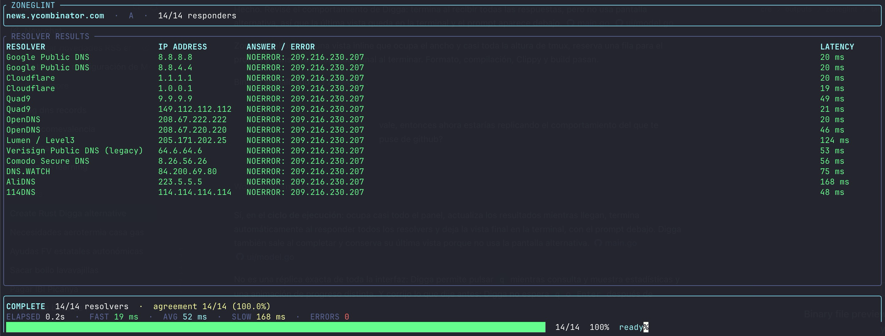

<div align="center">
  <h1>Zoneglint</h1>
  <p>See how public DNS resolvers differ in their answers and response times.</p>
  <p>
    <a href="https://github.com/nidr0x/zoneglint/actions/workflows/build.yml"></a>
    
  </p>
  <p>
    <a href="#features">Features</a> &middot;
    <a href="#install">Install</a> &middot;
    <a href="#usage">Usage</a> &middot;
    <a href="#resolver-selection">Resolvers</a> &middot;
    <a href="#network-and-privacy">Network and privacy</a>
  </p>
</div>

<p align="center">
  
</p>

<p align="center"><sub>Sample run for news.ycombinator.com; resolver answers and timings can change between runs.</sub></p>

Zoneglint is an independent Rust implementation of the resolver comparison workflow used by [digga](https://github.com/knowald/digga).

## Features

- Measure DNS replies and response times from 14 resolver addresses across 10 built-in public providers.
- Watch replies arrive in the terminal, or choose plain-text table or JSON output.
- Check resolver agreement for each DNS outcome, including negative responses and empty answer sets.
- Add public IPv4 resolvers found through [public-dns.info](https://public-dns.info/) when needed.

## Install

Get a prebuilt binary from the [Releases](https://github.com/nidr0x/zoneglint/releases/latest) page:

| Platform | Release asset |
| --- | --- |
| Linux x86_64 | `zoneglint-x86_64-unknown-linux-gnu` |
| macOS Apple silicon | `zoneglint-aarch64-apple-darwin` |
| macOS Intel | `zoneglint-x86_64-apple-darwin` |
| Windows x86_64 | `zoneglint-x86_64-pc-windows-msvc.exe` |

To build from source, install Rust 1.88 or newer and run:

```sh
git clone https://github.com/nidr0x/zoneglint.git
cd zoneglint
cargo build --locked --release
```

Cargo writes the executable to `target/release/zoneglint`, or `target/release/zoneglint.exe` on Windows.

## Usage

Once the binary is installed or available on your `PATH`:

```sh
zoneglint example.com
zoneglint example.com --type MX --simple
zoneglint example.com --json
zoneglint example.com --servers cloudflare,quad9 --timeout 3s
zoneglint example.com --fetch --fetch-count 20 --simple
```

By default, queries use the `A` record type. You can also query `AAAA`, `CNAME`, `MX`, `TXT`, `NS`, `SOA`, `PTR`, `SRV`, or `CAA`.

| Option | Description |
| --- | --- |
| `--type`, `-t` | Set the DNS record type; default is `A`. |
| `--json` | Write one formatted JSON document. This cannot be combined with `--simple`. |
| `--simple` | Use a plain-text table. This mode is selected automatically when stdout is redirected. |
| `--timeout` | Set a positive timeout for each resolver, such as `5s` or `800ms`; default is `5s`. |
| `--servers` | Choose built-in providers using a comma-separated list of IDs. |
| `--fetch` | Discover and add resolvers from public-dns.info. |
| `--fetch-count` | Set the discovery limit from 1 to 500; default is `30`. |

## Resolver selection

The built-in IDs are `google`, `cloudflare`, `quad9`, `opendns`, `level3`, `verisign`, `comodo`, `dnswatch`, `alidns`, and `114dns`; together they cover 14 resolver addresses. IDs accept either uppercase or lowercase letters.

The `level3` selection uses an IP address listed in [Lumen's hosted VoIP network guide](https://docs.lumen.com/voip/equipment/configuring-your-network-for-hosted-voip-service/). The `verisign` resolver remains marked legacy because current first-party service documentation is unavailable.

When `--fetch` is enabled, Zoneglint reads `https://public-dns.info/nameservers.csv`. It accepts IPv4 resolvers with reported reliability of 95% or higher, with no more than two entries from each country. If discovery fails, the program warns on stderr and proceeds with the built-in list.

## Output and consensus

With a terminal attached to stdout, Zoneglint displays progress as replies arrive. Matching answers appear in green, differing answers in yellow, and resolver errors in red. Redirected output uses the plain-text table; use `--json` for machine-readable results. Concurrency is capped at 32 resolver queries.

The propagation summary groups results by DNS response code and normalized answer records. Empty answers and negative DNS responses count as valid outcomes, while timeouts and transport errors stay in the total without joining a group. The consensus is `null` when the leading group is tied or no valid DNS response was received.

## Network and privacy

Zoneglint sends each requested query over UDP to the IP address of every selected resolver, without using the operating system's resolver. It does not keep query history or forward DNS requests to a Zoneglint service. It contacts public-dns.info only when you pass `--fetch`.
